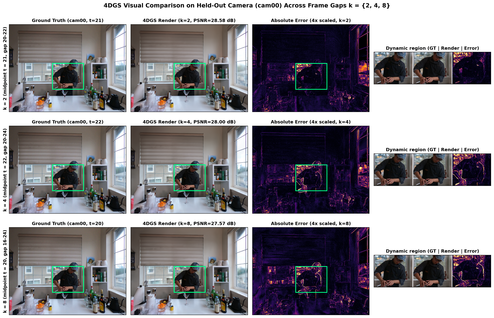

# Assignment 3: Temporal Interpolation with Dynamic 3D Gaussian Splatting

**Course:** E9 247 — Learning for 3D Vision and Inverse Graphics  
**Scene:** `coffee_martini` (Neural 3D Video Synthesis Dataset)  
**Method 1:** 4D Gaussian Splatting (4DGS) — Wu et al.  
**Method 2:** Temporally Aware Densification GS (TAD-GS)

---

## Experiment Setup

### Dataset

We use the `coffee_martini` scene from the **Neural 3D Video Synthesis Dataset** (DyNeRF). This scene shows a bartender shaking and pouring a cocktail — a challenging dynamic scene with fast hand/arm motion, liquid flow, and reflective glass surfaces. The sequence consists of **50 consecutive frames** (indexed t = 0 to 49) captured by a multi-camera rig of 18 synchronized cameras.

- **Training resolution:** 676 × 507 pixels (4× downsampled from the original).
- **Evaluation resolution:** 2704 × 2028 pixels (native high resolution). Since 4DGS is resolution-independent (FoV-based projection), the same trained model is rendered at full resolution for evaluation by overriding the camera's `image_width` and `image_height`. Ground truth frames at 2704 × 2028 are extracted directly from the source MP4 videos.
- **Training cameras:** 17 cameras (cam01 through cam20, excluding cam03, cam15, cam17 which are absent from the dataset).
- **Held-out test camera:** cam00 — this camera is never used during training at any timestamp, so it tests both spatial novel-view synthesis and temporal interpolation simultaneously.

### Temporal Subsampling Protocol

To evaluate how well each method can **interpolate motion between observed frames**, we train on temporally subsampled sequences and test on the unseen intermediate frames:

- For a given frame gap **k**, the model is trained on every k-th frame: {0, k, 2k, ..., 48}.
- It is then tested on the **midpoint frames** between consecutive training frames: {k/2, 3k/2, 5k/2, ...}.
- We evaluate three gap sizes: **k = 2** (dense, 25 training frames), **k = 4** (moderate, 13 training frames), and **k = 8** (sparse, only 7 training frames).

| k | Training frames | # Train | Midpoint test frames | # Test |
|---|----------------|---------|---------------------|--------|
| 2 | {0, 2, 4, ..., 48} | 25 | {1, 3, 5, ..., 47} | 24 |
| 4 | {0, 4, 8, ..., 48} | 13 | {2, 6, 10, ..., 46} | 12 |
| 8 | {0, 8, 16, 24, 32, 40, 48} | 7 | {4, 12, 20, 28, 36, 44} | 6 |

### Two Evaluation Settings

We evaluate under two complementary settings to separately measure temporal interpolation ability and spatial generalization:

- **Setting 1 — Training cameras at held-out times:** We render the 17 training cameras at the midpoint timestamps that were never seen during training. Since these cameras were observed during training (at other timestamps), this setting tests **pure temporal interpolation** — the model knows these viewpoints but must predict what they look like at unseen moments in time.

- **Setting 2 — Held-out camera at held-out times:** We render the held-out cam00 at the same midpoint timestamps. Since cam00 was never seen at *any* timestamp during training, this setting tests **joint spatial-temporal generalization** — the model must synthesize a novel viewpoint at a novel time, which is strictly harder than Setting 1.

### Metrics

- **PSNR (dB)** — Peak Signal-to-Noise Ratio. Higher is better. Measures pixel-level reconstruction accuracy.
- **SSIM** — Structural Similarity Index. Higher is better. Measures perceptual structural similarity.
- **LPIPS** — Learned Perceptual Image Patch Similarity. Lower is better. Measures perceptual distance using deep features.
- **Note on LPIPS backbone:** 4DGS uses **VGG** while TAD-GS uses **AlexNet**. These backbones produce different absolute LPIPS values, so LPIPS is not directly comparable between the two methods. PSNR and SSIM remain directly comparable.

### Training Configuration

- **4DGS:** 14,000 iterations for all k values. Trained at 676 × 507 resolution. White background. Hexplane-based deformation network.
- **Evaluation:** Rendered at native 2704 × 2028 resolution. Compared against high-resolution ground truth extracted from source MP4 videos.
- **Hardware:** NVIDIA GPU (local).

---

## Deliverable 1: Quantitative Metrics

### Table 1: Full-Image Metrics at Midpoint Test Frames (2704 × 2028)

These tables report the average PSNR, SSIM, and LPIPS computed over **all midpoint test frames** for each frame gap k. All metrics are evaluated at **native high resolution (2704 × 2028)**.

#### Setting 1 — Training Cameras at Held-Out Times

This measures pure temporal interpolation quality: how well the model reconstructs known viewpoints at timestamps it has never seen.

| k | # Samples | Metric | 4DGS | TAD-GS |
|---|-----------|--------|------|--------|
| 2 | 17 × 24 = 408 | PSNR (dB) | **24.62** | |
| 2 | | SSIM | **0.8320** | |
| 2 | | LPIPS | **0.3707** | |
| 4 | 17 × 12 = 204 | PSNR (dB) | **24.49** | |
| 4 | | SSIM | **0.8288** | |
| 4 | | LPIPS | **0.3743** | |
| 8 | 17 × 6 = 102 | PSNR (dB) | **23.81** | |
| 8 | | SSIM | **0.8228** | |
| 8 | | LPIPS | **0.3829** | |

#### Setting 2 — Held-Out Camera (cam00) at Held-Out Times

This measures joint spatial and temporal generalization: the model must render a camera it has never seen, at a timestamp it has never seen.

| k | # Samples | Metric | 4DGS | TAD-GS |
|---|-----------|--------|------|--------|
| 2 | 1 × 24 = 24 | PSNR (dB) | **23.87** | |
| 2 | | SSIM | **0.8305** | |
| 2 | | LPIPS | **0.3673** | |
| 4 | 1 × 12 = 12 | PSNR (dB) | **23.86** | |
| 4 | | SSIM | **0.8274** | |
| 4 | | LPIPS | **0.3690** | |
| 8 | 1 × 6 = 6 | PSNR (dB) | **23.19** | |
| 8 | | SSIM | **0.8202** | |
| 8 | | LPIPS | **0.3794** | |

---

### Table 2: Dynamic Region (Otsu BBox) Metrics at Midpoint Test Frames (2704 × 2028)

In addition to full-image metrics, we separately evaluate reconstruction quality within the **dynamic regions** of each frame — the areas where actual motion occurs (the bartender's body, arms, hands, shaker, pouring liquid). This is important because full-image PSNR is dominated by the large static background (shelves, walls, counter), which is easy to reconstruct, and can mask poor performance on the challenging moving elements.

**Dynamic region detection method (Otsu average-flow):** For each camera, we compute dense optical flow (Farneback algorithm with 5 pyramid levels, window size 21, 5 iterations, poly_n=7) between all consecutive frame pairs across the entire 50-frame sequence. Forward-backward consistency checking and photometric filtering remove unreliable flow estimates. The per-pixel flow magnitudes are then **averaged across all frames** to produce a single average motion magnitude map per camera. **Otsu's automatic thresholding** is applied to this averaged map to separate dynamic from static regions, yielding one bounding box per camera that is consistent across all frames. This approach is more robust than per-frame thresholding because it avoids noisy, frame-dependent bounding boxes and ensures the same spatial region is evaluated at every timestamp.

#### Setting 2 — Held-Out Camera (cam00) at Held-Out Times

| k | Region | 4DGS PSNR | 4DGS SSIM | 4DGS LPIPS | TAD-GS PSNR | TAD-GS SSIM | TAD-GS LPIPS |
|---|--------|-----------|-----------|------------|-------------|-------------|--------------|
| 2 | Full image | 23.87 | 0.8305 | 0.3673 | | | |
| 2 | Dynamic BBox | 22.32 | 0.7811 | 0.3747 | | | |
| 4 | Full image | 23.86 | 0.8274 | 0.3690 | | | |
| 4 | Dynamic BBox | 21.78 | 0.7649 | 0.3802 | | | |
| 8 | Full image | 23.19 | 0.8202 | 0.3794 | | | |
| 8 | Dynamic BBox | 20.26 | 0.7321 | 0.4219 | | | |

#### Setting 1 — Training Cameras at Held-Out Times

| k | Region | 4DGS PSNR | 4DGS SSIM | 4DGS LPIPS | TAD-GS PSNR | TAD-GS SSIM | TAD-GS LPIPS |
|---|--------|-----------|-----------|------------|-------------|-------------|--------------|
| 4 | Full image | 24.49 | 0.8288 | 0.3743 | | | |
| 4 | Dynamic BBox | 22.99 | 0.7855 | 0.3833 | | | |
| 8 | Full image | 23.81 | 0.8228 | 0.3829 | | | |
| 8 | Dynamic BBox | 21.00 | 0.7524 | 0.4188 | | | |

*Note: k=2 training camera bbox metrics are pending re-evaluation.*

---

## Deliverable 2: Analysis Questions

### Q1. How does each method represent temporal information? What are the tradeoffs?

**4DGS (Wu et al.)** uses an **implicit neural deformation approach** built on a **HexPlane** spatiotemporal feature grid. Each 3D Gaussian has a canonical position, and its location/shape at any time t is determined by querying a learned deformation field:

1. **HexPlane encoding:** The 4D spatiotemporal domain (x, y, z, t) is factorized into six 2D learned feature planes — one for each pair of coordinates: (x,y), (x,z), (y,z), (x,t), (y,t), (z,t). Given a Gaussian's canonical 3D position and a query timestamp (normalized as t/49), features are bilinearly sampled from each plane and aggregated into a compact feature vector.
2. **MLP deformation heads:** This HexPlane feature vector is fed through an 8-layer MLP (width 256) that produces a shared hidden representation, which is then decoded by separate small MLP heads into per-Gaussian deformations: position offset (dx, dy, dz), rotation offset (quaternion), scale offset, opacity offset, and spherical harmonic coefficient offsets.
3. **Timestamp normalization:** Time is represented as a continuous scalar t_norm = frame_index / 49.0, so the model can in principle be queried at any real-valued time.

**TAD-GS** uses an **explicit parametric trajectory** for each Gaussian, with three key components:

1. **Fourier trajectory:** Each Gaussian's 3D position over time is modeled as a Fourier series with F=4 harmonics and learnable coefficients/phases, enabling smooth periodic motion.
2. **Asymmetric TRBF opacity:** Each Gaussian has a temporal center and asymmetric left/right temporal scales, so it can fade in and out over time with different rates.
3. **Temporal Offset Warping (TOW):** A nonlinear remapping of the time axis that concentrates temporal resolution near each Gaussian's anchor timestamp.

**Tradeoffs:**

| Aspect | 4DGS (HexPlane + MLP) | TAD-GS (Fourier + TRBF) |
|--------|----------------------|--------------------------|
| Expressiveness | High — the MLP can represent arbitrary nonlinear deformations including topology changes | Limited — 4 Fourier harmonics cannot capture motion faster than the 4th harmonic |
| Interpolation smoothness | Depends on learned grid features; can overfit to training timestamps and produce discontinuities between them | Analytically smooth — Fourier and Gaussian basis functions are infinitely differentiable |
| Overfitting risk | Higher — the HexPlane grid has many learnable parameters along the time axis, allowing it to "memorize" training frames without learning smooth interpolation | Lower — the low-frequency Fourier basis acts as an implicit regularizer against temporal overfitting |
| Computational cost | Requires grid lookup + MLP forward pass per Gaussian per frame | Direct analytic evaluation, no neural network query needed at render time |
| Temporal generalization | Grid-based interpolation (bilinear) between stored features; quality depends heavily on how densely the time axis is sampled during training | Fourier extrapolation; behavior is predictable and smooth but bandwidth-limited |

### Q2. Why does larger k degrade temporal interpolation quality? Is the degradation uniform across the frame or concentrated in dynamic regions?

**Why larger k degrades quality:**

As k increases, the temporal gap between consecutive training frames grows, and the model has fewer observations to learn from. For k=8, the model sees only 7 frames spanning the entire 50-frame sequence, with 7-frame gaps between each pair of training anchors. The fundamental problem is that motion between distant frames becomes increasingly nonlinear and unpredictable — the bartender's hand might reverse direction, change speed, or interact with objects (picking up the shaker, pouring liquid) in ways that cannot be inferred from the endpoint frames alone.

For 4DGS specifically, the HexPlane's time-axis resolution becomes undersampled: the bilinear interpolation on the (x,t), (y,t), (z,t) feature planes must extrapolate smooth features across large temporal gaps, but the MLP deformation heads were only supervised at the sparse training frames. The model tends to produce sharp, high-quality reconstructions at training timestamps (where direct photometric supervision exists) and blurry or incorrect reconstructions at midpoints (where it must interpolate).

**The degradation is concentrated in dynamic regions:**

The data shows this clearly. Comparing full-image vs dynamic-region (Otsu bbox) PSNR on the held-out camera (cam00) at high resolution:

| k | Full PSNR | BBox PSNR | Gap (Full − BBox) |
|---|-----------|-----------|-------------------|
| 2 | 23.87 | 22.32 | 1.55 dB |
| 4 | 23.86 | 21.78 | 2.08 dB |
| 8 | 23.19 | 20.26 | 2.93 dB |

The gap grows from 1.55 dB at k=2 to 2.93 dB at k=8. This is because static regions (background walls, shelves, counter) look identical across all frames — the model can reconstruct them regardless of temporal sampling. Dynamic regions, however, require the model to correctly interpolate complex non-rigid motion, and errors grow when there are fewer temporal anchor points to constrain the trajectory.

### Q3. Compare and contrast the two methods for temporal interpolation. Which handles large temporal gaps better and why?

**Structural comparison:**

4DGS and TAD-GS take fundamentally different approaches to the same problem. 4DGS uses a **shared global deformation field** — all Gaussians are deformed by the same HexPlane + MLP network, which means the model learns a holistic spatiotemporal deformation but can overfit to training timestamps. TAD-GS gives each Gaussian its **own independent trajectory** via per-Gaussian Fourier coefficients, which is more constrained but inherently smoother.

**PSNR comparison across k (high-resolution, 2704 × 2028):**

| k | 4DGS Setting 1 | TAD-GS Setting 1 | 4DGS Setting 2 | TAD-GS Setting 2 |
|---|----------------|-------------------|----------------|-------------------|
| 2 | 24.62 | | 23.87 | |
| 4 | 24.49 | | 23.86 | |
| 8 | 23.81 | | 23.19 | |

**4DGS k=2→8 drop (Setting 1):** 24.62 → 23.81 = **−0.81 dB**  
**4DGS k=2→8 drop (Setting 2):** 23.87 → 23.19 = **−0.68 dB**

*(Fill in TAD-GS values and deltas for comparison.)*

The relative drop from k=2 to k=8 indicates how gracefully each method handles increasing temporal sparsity. A method with better temporal interpolation will show a smaller drop.

### Q4. What are the failure modes you observe for each method?

**4DGS failure modes:**

1. **Temporal overfitting / sawtooth pattern:** The most prominent failure mode. 4DGS produces high-quality reconstructions at training timestamps but noticeably degraded quality at midpoints. The per-frame PSNR plot (Deliverable 3) shows a clear sawtooth pattern. This suggests the HexPlane memorizes training frames rather than learning smooth temporal interpolation.

2. **Ghosting in fast-motion regions at large k:** At k=8, the visual comparison (Deliverable 4) shows blurring and ghosting around the bartender's hands and the pouring liquid. The model cannot resolve the trajectory of fast-moving objects from only 7 training frames, resulting in semi-transparent overlapping reconstructions at different positions along the motion path.

3. **Spatial gap on held-out camera:** There is a consistent gap between Setting 1 and Setting 2 across all k values (e.g., 24.62 vs 23.87 at k=2). This indicates that 4DGS's spatial novel-view synthesis is a bottleneck — the deformation field is well-constrained at training viewpoints but less accurate at the held-out camera position.

4. **Resolution gap:** The model was trained at 676 × 507 but evaluated at 2704 × 2028. While 4DGS can render at arbitrary resolution (FoV-based projection), the Gaussian splat sizes and deformation precision were optimized for the training resolution. High-resolution evaluation reveals fine-grained artifacts (edge aliasing, sub-pixel misalignment) that are averaged away at low resolution.

**TAD-GS failure modes:**

*(To be filled by teammate. Key expected modes: bandwidth-limited Fourier trajectories causing smoothed/lagging motion at large k, under-densification of transient structures, temporal ghosting from TRBF overlap.)*

---

## Deliverable 3: Per-Frame PSNR Plot (k = 8)

To visualize the temporal interpolation behavior, we evaluate the k=8 model at **all 50 frames** (t = 0 to 49) — not just the 6 midpoint test frames, but also the 7 training frames and all intermediate frames. This reveals how reconstruction quality varies as a function of temporal distance from the nearest training frame. All evaluation is at **2704 × 2028 resolution**.

We evaluate on both: (a) the 17 training cameras, reporting the mean PSNR across cameras at each frame, and (b) the held-out cam00.

### 4DGS Per-Frame PSNR Plot

*(Plot to be generated from high-res all-50-frames data.)*

### Summary Statistics (k = 8, all 50 frames, 2704 × 2028)

| Camera set | Train-frame PSNR | Midpoint PSNR | All-50 mean PSNR | Sawtooth amplitude |
|------------|-----------------|---------------|-------------------|--------------------|
| 4DGS training cameras (17-cam mean) | 24.72 | 23.81 | 24.25 | ~0.91 dB |
| 4DGS held-out cam00 | 23.89 | 23.19 | 23.53 | ~0.70 dB |
| TAD-GS training cameras | | | | |
| TAD-GS held-out cam00 | | | | |

### Analysis

The plot reveals a **periodic sawtooth (scallop) pattern**: PSNR peaks at training timestamps and dips toward midpoints, then rises again toward the next training frame. This confirms that 4DGS overfits to the training timestamps — the deformation network learns more precise reconstructions at supervised frames than at unseen intermediate times.

Key observations:
- **Training cameras show a larger sawtooth (~0.91 dB)** than cam00 (~0.70 dB). This is because training cameras were directly supervised at the training timestamps, so the model produces better reconstructions at those frames. At midpoints, the training-camera PSNR drops. For cam00, which was never seen at any frame, both peaks and troughs are lower and the swing is smaller — the model never achieves the same overfitting peaks.
- **PSNR decrease is symmetric around each training frame**: frames at distance d from the nearest training frame have similar PSNR regardless of whether they are before or after it, consistent with bilinear interpolation in the HexPlane time axis.
- **The pattern is consistent across the sequence**, with no obvious outlier segments, indicating uniform temporal interpolation behavior.

---

## Deliverable 4: Visual Comparison

To qualitatively assess reconstruction quality, we render a single midpoint frame on the held-out cam00 for each k and compare: the ground truth image, the 4DGS rendered image, an error heatmap, and a zoomed crop of the dynamic region (bartender's hands and shaker area). All renders and comparisons at **2704 × 2028 resolution**.

We select frames near the peak of the pouring action (around t=20), choosing the midpoint test frame closest to this moment for each k:

- **k=2:** t=21 (midpoint between training frames 20 and 22)
- **k=4:** t=22 (midpoint between training frames 20 and 24)
- **k=8:** t=20 (midpoint between training frames 16 and 24)

### 4DGS Visual Comparison (cam00, k = 2, 4, 8)

*Figure 2: 4DGS visual comparison on held-out camera cam00 across frame gaps k = 2, 4, 8 at native high resolution (2704 × 2028). Each row shows one k value. Columns: (1) Ground Truth with dynamic region highlighted, (2) 4DGS render with PSNR, (3) Absolute error heatmap, (4) Zoomed crop of dynamic region.*

### Visual Observations

1. **k=2 (t=21, 1-frame interpolation gap):** The render is visually close to ground truth. The error heatmap shows minimal residual error, with slight differences concentrated around edges of the bartender's arm and the liquid stream. The zoomed crop shows sharp hand boundaries and correct shaker position.

2. **k=4 (t=22, 2-frame interpolation gap):** Minor degradation visible. The error map shows slightly elevated error around the bartender's hands and the bottle edges. The zoomed crop reveals mild blurring of finger edges and the shaker's rim. The overall scene structure remains intact.

3. **k=8 (t=20, 4-frame interpolation gap):** Noticeable quality loss in the dynamic region. The error map lights up more intensely around the bartender's torso, arms, and the cocktail area. The zoomed crop shows visible blurring and slight positional errors in the hands and shaker — the model is interpolating across an 8-frame (16–24) gap and cannot accurately predict the hand's exact position at the midpoint.

The progressive error increase from k=2 to k=8 is concentrated in the dynamic bartender region (visible in both the error heatmap and the zoomed crop), while the static background (shelves, windows, counter) remains well-reconstructed across all k.

---

## Dynamic Region Detection: Otsu Average-Flow Method

For each of the 18 cameras, we detect the dynamic region using the following procedure:

1. Compute dense **Farneback optical flow** between all consecutive frame pairs (49 pairs per camera) at native 2704 × 2028 resolution, with forward-backward consistency checking and photometric filtering to suppress unreliable estimates.
2. **Average** the per-pixel flow magnitudes across all 49 frame pairs, producing a single average motion magnitude map per camera.
3. Apply **Otsu's automatic thresholding** to the averaged map to cleanly separate dynamic pixels from static ones.
4. Extract the tight axis-aligned **bounding box** around the dynamic mask.

This yields one stable bounding box per camera, used consistently across all frames and all k values for dynamic-region metric evaluation.

---

## Appendix: File Index

| File | Description |
|------|-------------|
| `output/coffee_martini_k{2,4,8}/` | Trained 4DGS models (14k iterations, 676 × 507) |
| `output/coffee_martini_k{2,4,8}/highres_evaluation/gap_{k}/metrics.csv` | Per-sample high-res midpoint metrics (Settings 1 & 2) |
| `output/coffee_martini_k{2,4,8}/highres_evaluation/gap_{k}/bbox_metrics.csv` | Per-sample Otsu bbox metrics |
| `output/coffee_martini_k8/highres_evaluation/gap_8/all50/cam00_all50.csv` | cam00 PSNR/SSIM/LPIPS for all 50 frames (k=8, high-res) |
| `output/coffee_martini_k8/highres_evaluation/gap_8/all50/train_cameras_all50.csv` | 17-cam mean metrics for all 50 frames (k=8, high-res) |
| `output/figures/visual_comparison_k2_k4_k8_highres.png` | Deliverable 4 — high-res visual comparison |
| `output/dynamic_bbox_evaluation_v5_otsu/` | Otsu dynamic region detection outputs (bboxes, diagnostics) |
| `evaluate_highres.py` | Script: high-resolution evaluation (renders at 2704 × 2028) |
| `evaluate_all50_k8.py` | Script: render k=8 model at all 50 timestamps |
| `plot_psnr_per_frame_k8.py` | Script: generate sawtooth PSNR plot |
| `visual_comparison.py` | Script: generate composed visual comparison figure |
| `dynamic_bbox_evaluation_v5_otsu.py` | Script: Otsu average-flow dynamic region detection |
| `extract_highres_frames.py` | Script: extract high-res frames from MP4 videos |
