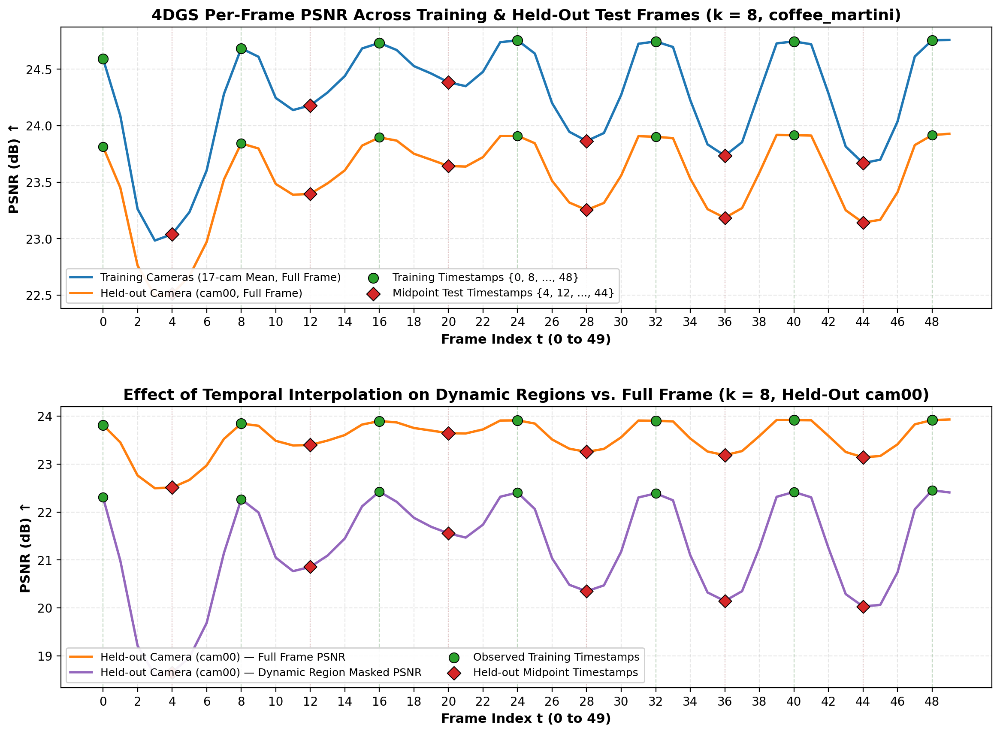
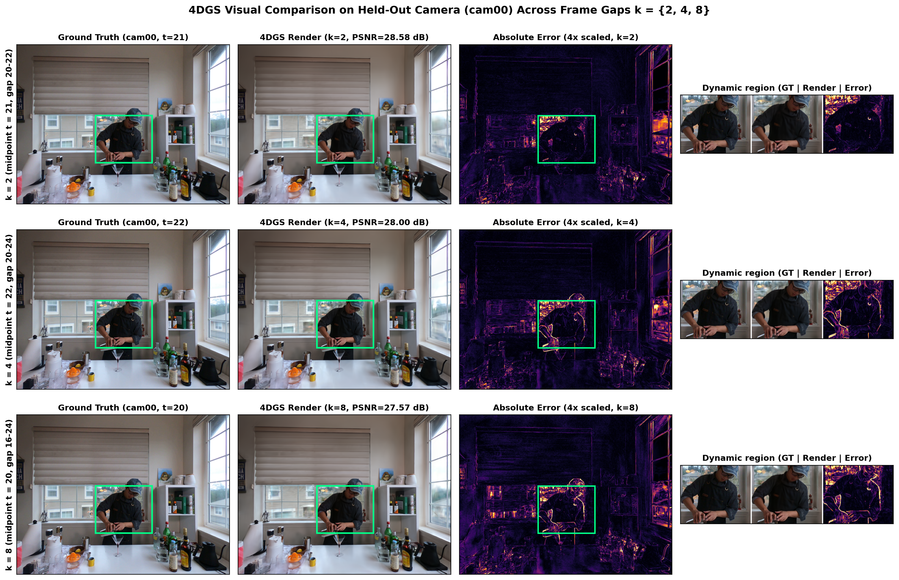

# 4DGS — Submission Data

**Scene:** `coffee_martini` | **Training:** 14,000 iterations | **Train res:** 676×507 | **Eval res:** 2704×2028  
**LPIPS backbone:** VGG | **Dynamic region:** Otsu average-flow bounding box

---

## Deliverable 1: Quantitative Metrics (2704×2028)

### Full-Image — Setting 1 (Training Cameras, Held-Out Times)

| k | # Samples | PSNR ↑ | SSIM ↑ | LPIPS ↓ |
|---|-----------|--------|--------|---------|
| 2 | 408 | 24.62 | 0.8320 | 0.3707 |
| 4 | 204 | 24.49 | 0.8288 | 0.3743 |
| 8 | 102 | 23.81 | 0.8228 | 0.3829 |

### Full-Image — Setting 2 (Held-Out cam00, Held-Out Times)

| k | # Samples | PSNR ↑ | SSIM ↑ | LPIPS ↓ |
|---|-----------|--------|--------|---------|
| 2 | 24 | 23.87 | 0.8305 | 0.3673 |
| 4 | 12 | 23.86 | 0.8274 | 0.3690 |
| 8 |  6 | 23.19 | 0.8202 | 0.3794 |

### Dynamic Region (Otsu BBox) — Setting 1 (Training Cameras)

| k | Full PSNR | BBox PSNR | Full SSIM | BBox SSIM | Full LPIPS | BBox LPIPS |
|---|-----------|-----------|-----------|-----------|------------|------------|
| 2 | 24.62 | 23.77 | 0.8320 | 0.8023 | 0.3707 | 0.3739 |
| 4 | 24.49 | 22.99 | 0.8288 | 0.7855 | 0.3743 | 0.3833 |
| 8 | 23.81 | 21.00 | 0.8228 | 0.7524 | 0.3829 | 0.4188 |

### Dynamic Region (Otsu BBox) — Setting 2 (Held-Out cam00)

| k | Full PSNR | BBox PSNR | Full SSIM | BBox SSIM | Full LPIPS | BBox LPIPS |
|---|-----------|-----------|-----------|-----------|------------|------------|
| 2 | 23.87 | 22.32 | 0.8305 | 0.7811 | 0.3673 | 0.3747 |
| 4 | 23.86 | 21.78 | 0.8274 | 0.7649 | 0.3690 | 0.3802 |
| 8 | 23.19 | 20.26 | 0.8202 | 0.7321 | 0.3794 | 0.4219 |

---

## Deliverable 3: Per-Frame PSNR (k=8, All 50 Frames, 2704×2028)

### Summary Statistics

| Camera Set | Train-Frame PSNR | Midpoint PSNR | All-50 Mean | Sawtooth Δ |
|------------|-----------------|---------------|-------------|------------|
| Training cameras (17-cam mean) | 24.72 | 23.81 | 24.25 | 0.91 dB |
| Held-out cam00 | 23.89 | 23.19 | 23.53 | 0.70 dB |

---

## Deliverable 4: Visual Comparison (cam00, 2704×2028)

---

## Degradation Analysis

### Full-Image PSNR Drop (k=2 → k=8)

| Setting | k=2 | k=8 | Drop |
|---------|-----|-----|------|
| Setting 1 (train cams) | 24.62 | 23.81 | −0.81 dB |
| Setting 2 (cam00) | 23.87 | 23.19 | −0.68 dB |

### Full vs Dynamic Region Gap (grows with k)

| Setting | k=2 gap | k=4 gap | k=8 gap |
|---------|---------|---------|---------|
| Setting 1 (train cams) | 0.85 dB | 1.50 dB | 2.81 dB |
| Setting 2 (cam00) | 1.55 dB | 2.08 dB | 2.93 dB |
