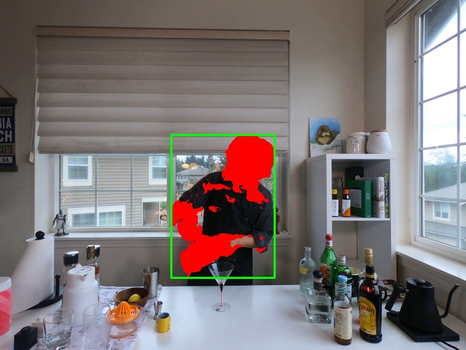
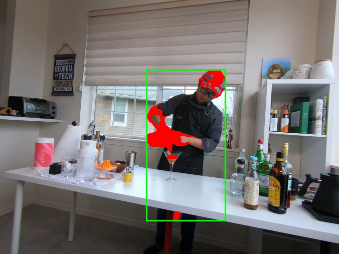
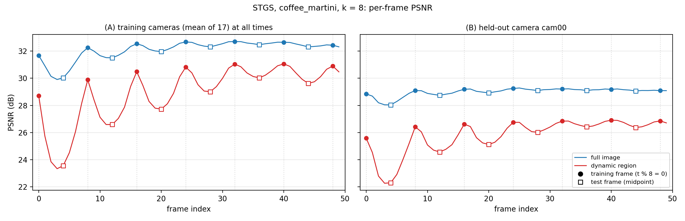
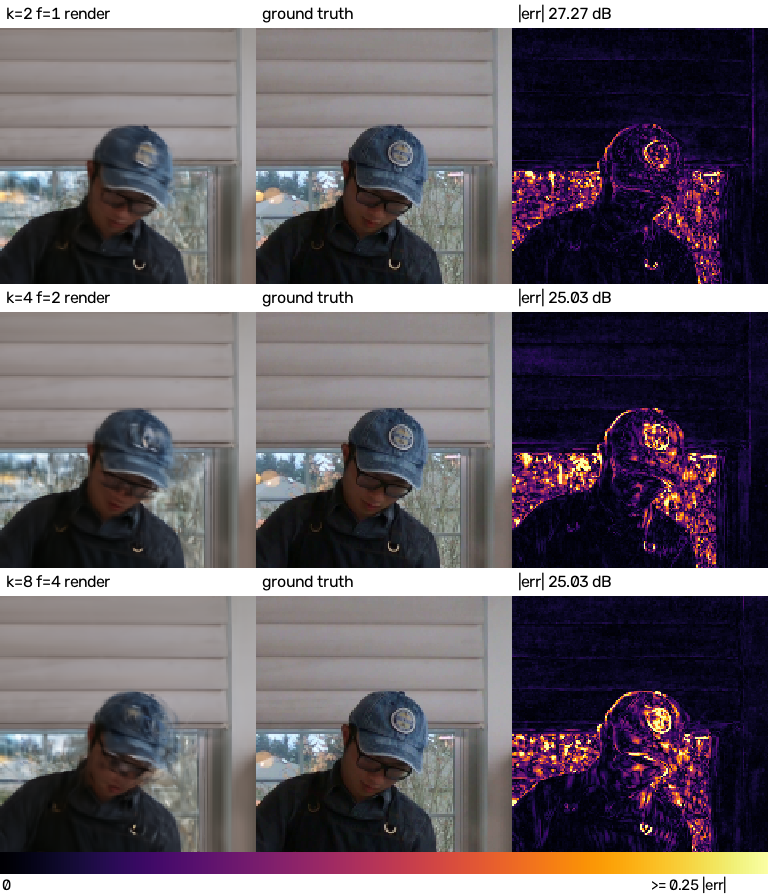
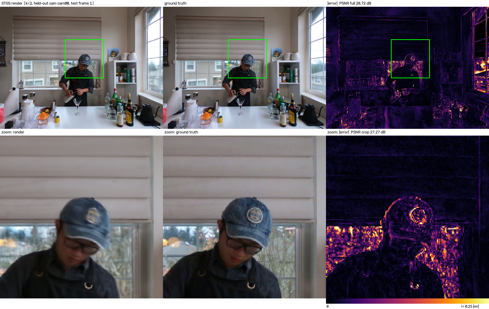
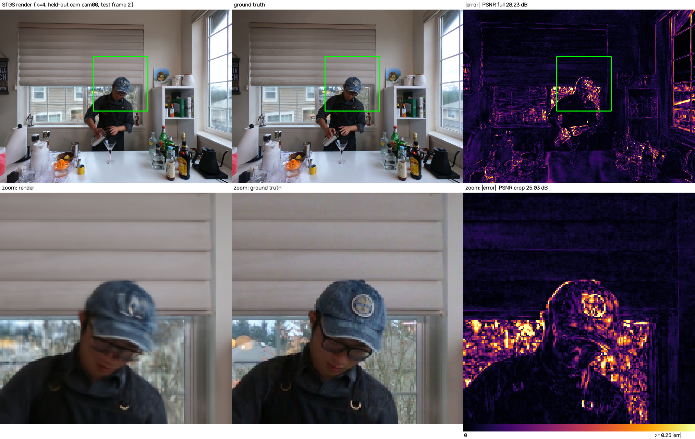
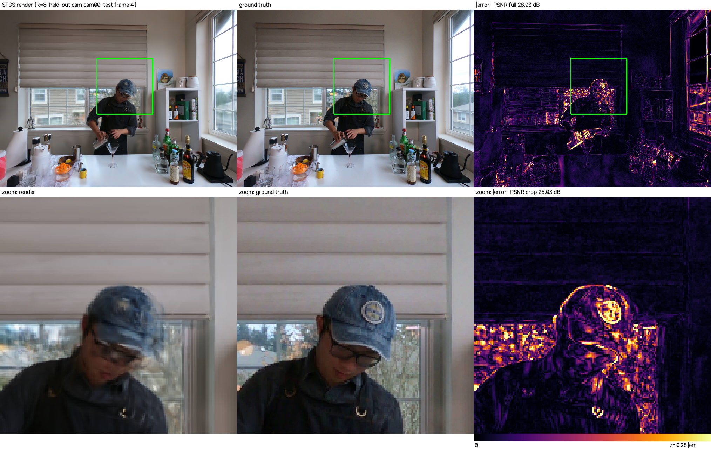
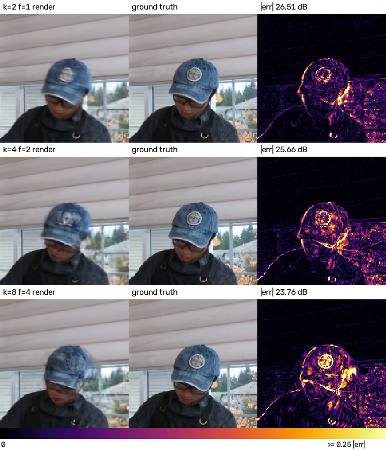

# Assignment 3 — Temporal Interpolation with Dynamic 3DGS: Spacetime Gaussians (STGS)

Method: **Spacetime Gaussians, full model** (Li et al., CVPR 2024; code: oppo-us-research/SpacetimeGaussians, commit 427abfc).
Code: https://github.com/Sharkum/3DVision-Assignment3/tree/stgs

## 1. Experiment details

| Item | Setting |
|---|---|
| Scene | Neural 3D Video, `coffee_martini` (18 cameras; cam03/15/17 not in the release) |
| Frames | 0–49 (first 50 of 300, 30 fps) |
| Resolution | 676×507 (4× downsample of 2704×2028, `cv2.INTER_AREA`) |
| Gap k | 2, 4, 8. Train frames {0, k, 2k, …, 48}. Test frames {k/2, 3k/2, …} = 24 / 12 / 6 frames. Frame 49 is not used in any average. |
| Held-out camera | **cam00** (dataset standard), never used for training |
| Test settings | (A) the 17 training cameras at test frames; (B) cam00 at test frames |
| Hardware | 1× NVIDIA RTX A5000 (24 GB), SLURM. Training ≈ 15 min per k; rendering 900 images ≈ 2.5 min |
| Software | Python 3.7.13, PyTorch 1.12.1 + CUDA 11.6, COLMAP 4.2.0 (CPU, for initial points) |

**Hyperparameters** (authors' N3V full config, same for every k): 30 000 iterations, batch 2 views, `duration = 50` (t = frame/50), polynomial motion of degree 3, linear rotation, 9-D features + "sandwich" MLP colour decoder, densify every 100 iterations from 500 to 9000 (grad threshold 2e-4), opacity reset every 3000 iterations, error-guided sampling from iteration 1600, Gaussian cap 330k. Learning rates: position 1.6e-4 → 1.6e-6, scaling 3e-3, opacity 0.05, rotation 1e-3, features 2.5e-3, temporal centre 1e-4, temporal scale 0.03.

**No test leakage.** With gap k, the model only sees training frames: training images, time sampling (`t` drawn from {0, k, 2k, …}) and initial point cloud (per-frame COLMAP points from training frames only).

**Deviations from the authors' defaults**
- 4× instead of 2× downsampling.
- Training restricted to frames t mod k = 0 (added option `--trainstride k`).
- Initial points from COLMAP 4.2 `point_triangulator` with the known poses. Undistortion skipped, since the cameras are PINHOLE with no distortion.
- As in the authors' pipeline, the triangulation uses all 18 cameras, including cam00, at the **training** frames only.

**Arbitrary time.** STGS is continuous in t, so test frames are rendered directly at t = f/50. No interpolation rule is needed.

## 2. Dynamic-region mask (team-common)

We use the mask shared by the whole team (team repo, `TADGS` branch @6e8703c, `scripts/otsu_avg_flow_bbox.py`; the algorithm is copied unchanged into `STGS/analysis/otsu_bbox_mask.py`). It is computed from the ground-truth video only. There is one mask per camera, used for all 50 frames, every k and every method:

1. Farneback optical flow (OpenCV; 3 pyramid levels, scale 0.5, window 15, 3 iterations, poly_n 5, poly_sigma 1.2) from frame t to t+2 (t−2 for frames 48–49). Flow is kept only where the forward-backward error is < 0.5·|flow| + 0.75 px and the blurred photometric change is > 0.012.
2. The flow magnitude is averaged over all 50 frames.
3. The threshold is chosen by **Otsu's method** on this average (computed on the map scaled to 0–255). Per camera it is 0.13–0.43 px (cam00: 0.38 px).
4. The mask is the **smallest axis-aligned box** enclosing all pixels above the threshold.

The box covers 11.3% of the image on average (range 8.5–16.0%; cam00: 9.2%). No mask is empty. The pixels above the threshold cover 1.5–4.3% of the image, so the box still contains some static pixels around the bartender. A few stray pixels can stretch the box, as on cam13, where pixels near the floor extend it downwards.

An earlier team mask (one box per frame, fixed threshold 0.5 px) covered 41.6% of the image on average and was empty or above 90% of the frame on 30 images. It mixed in much more static background, so we no longer use it.

| cam00 (9.2% of the image) | cam13 (14%; box stretched by stray pixels) |
|---|---|
|  |  |

*Frame 20. Red: pixels whose average flow is above the Otsu threshold. Green: the mask (their smallest enclosing box).*

Restricted metrics, using the STGS repo's metric code:
- **PSNR:** MSE over the masked pixels only.
- **SSIM:** the repo's SSIM map (`ssimmap`) averaged over the masked pixels.
- **LPIPS:** the repo's LPIPS-Alex on the image cropped to the box. All boxes are at least 149 px wide, so LPIPS is computed for every image.

## 3. Quality (test frames, averaged over test frames)

Full-image metrics use the STGS repo's code (`psnr`, `ssim`, LPIPS-Alex v0.1, as in the authors' `test.py`), on renders computed in memory.

| k | Setting | #img | PSNR ↑ | SSIM ↑ | LPIPS ↓ | Dyn PSNR ↑ | Dyn SSIM ↑ | Dyn LPIPS ↓ | Mask area |
|---|---|---|---|---|---|---|---|---|---|
| 2 | A: train cams | 408 | 33.29 | 0.9522 | 0.0357 | 31.19 | 0.9318 | 0.0338 | 11.4% |
| 2 | B: cam00 | 24 | 28.91 | 0.9235 | 0.0421 | 27.29 | 0.8947 | 0.0534 | 9.2% |
| 4 | A: train cams | 204 | 32.86 | 0.9486 | 0.0390 | 30.30 | 0.9211 | 0.0392 | 11.4% |
| 4 | B: cam00 | 12 | 28.90 | 0.9198 | 0.0433 | 25.17 | 0.8662 | 0.0629 | 9.2% |
| 8 | A: train cams | 102 | 31.76 | 0.9402 | 0.0446 | 27.75 | 0.8813 | 0.0529 | 11.4% |
| 8 | B: cam00 | 6 | 28.82 | 0.9142 | 0.0467 | 25.13 | 0.8360 | 0.0735 | 9.2% |

Mask area for A is the mean over the 17 training cameras. Test frames per camera: 24 / 12 / 6 for k = 2 / 4 / 8.

For reference, PSNR at the **training** frames:

| k | A: PSNR | A: dyn PSNR | B: PSNR | B: dyn PSNR |
|---|---|---|---|---|
| 2 | 33.24 | 31.18 | 28.88 | 27.27 |
| 4 | 32.92 | 30.81 | 28.91 | 25.36 |
| 8 | 32.41 | 30.41 | 29.12 | 26.57 |

## 4. Per-frame PSNR, k = 8

*Filled circles mark training frames (0, 8, …, 48) and open squares mark test frames. Blue is the full image, red the dynamic region. (A) is the mean over the 17 training cameras, (B) is cam00.*

*The dynamic-region PSNR peaks at every training frame and drops between them, in both panels. The mask is fixed per camera, so these dips come from the renders, not from the mask moving. The deepest dip is at frame 4: 23.6 dB in (A) and 22.3 dB in (B). The full-image curve shows the same pattern but much flatter.*

## 5. Visual results (test frames, fast-moving region)

For each k, the frame shown is the test frame with the most ground-truth motion (Farneback flow between consecutive frames, averaged over moving pixels). The crop (160×160) is centred on the flow peak. The error map shows |render − GT| averaged over RGB, on a fixed scale of 0–0.25.

Held-out cam00, crops for k = 2, 4, 8:

Full frames with the crop box:
- k = 2: 
- k = 4: 
- k = 8: 

Training camera cam01 (setting A), crops for k = 2, 4, 8:

As k grows, the cap's logo and the face blur and then double. The error concentrates on the moving head and hands, while the static blinds stay dark.

## 6. Answers

**Q1. How does STGS represent time, and what does that predict?**

Each Gaussian *i* has a temporal centre μᵢᵗ and a temporal scale sᵢᵗ:
- **Opacity** is a temporal radial basis function: σᵢ(t) = σᵢˢ·exp(−sᵢᵗ |t − μᵢᵗ|²).
- **Position** is a cubic polynomial: μᵢ(t) = Σ_{j=0..3} bᵢⱼ (t − μᵢᵗ)ʲ.
- **Rotation** is linear in t.
- **Colour** comes from 9-D features, including a time-dependent term, decoded by a small MLP.

Because everything is a smooth function of continuous t, any t can be rendered. This predicts:
- **Slow or smooth motion** should interpolate well.
- **Fast or non-polynomial motion** between training frames should degrade, because a cubic fitted only at training frames can overshoot.
- **Gaps longer than a Gaussian's temporal support** should show blur or ghosting, because a Gaussian fades out before the next training frame and the others are not constrained there.
- **Static content** should be unaffected.

**Q2. How does quality change with k, and when does it fail?**

Test-frame quality falls as k grows (setting A):
- Full-image PSNR: 33.29 → 32.86 → 31.76 dB.
- Dynamic-region PSNR: 31.19 → 30.30 → 27.75 dB.

The interpolation cost is the dynamic-region PSNR at training frames minus that at test frames: −0.01 dB at k = 2, 0.51 dB at k = 4 and 2.65 dB at k = 8. At k = 2 there is no cost. At k = 4 it is small, and at k = 8 it is clear. These are single runs without a fixed seed, so differences of a few tenths of a dB may be within run-to-run noise (not measured).

At k = 8, the per-frame plot dips at every test frame (Section 4). The dip is largest in frames 0–16, where the bartender moves fastest: setting A dynamic PSNR is 23.6 dB at frame 4, against 28.7 and 29.9 dB at training frames 0 and 8. Later in the video the dips are smaller, e.g. 30.0 dB at frame 36 against 31.0 and 31.1 dB at frames 32 and 40. In the fast frames the cap, face and hands are blurred or doubled (Section 5). STGS therefore fails when a large gap meets fast motion.

**Q3. Is there a gap between dynamic regions and the rest of the image?**

Yes, and it grows with k. In setting A, dynamic PSNR is below full-image PSNR by 2.10 / 2.56 / 4.01 dB for k = 2 / 4 / 8. Part of the gap exists even at training frames (2.06 / 2.11 / 2.00 dB), because moving content is harder to fit than the static background. The part that grows with k comes from interpolation. The static background is fitted equally well at every frame, so full-image metrics hide most of the interpolation error. The box still contains some static pixels (Section 2), so the true gap on moving pixels alone is likely larger.

Only one method was run here, so whether the gap depends on the method is answered in the comparison with the other methods.

**Q4. Does the held-out camera behave differently?**

Yes:
- cam00 is about 4.4 dB below the training cameras at k = 2 (28.91 vs 33.29), and its full-image PSNR is almost constant over k (28.91 / 28.90 / 28.82). The novel-view error dominates and does not depend on k.
- The temporal effect is still visible in cam00's dynamic region: 27.29 → 25.17 → 25.13 dB, a drop of 2.2 dB (setting A: 3.4 dB). The interpolation cost on cam00 is −0.02 / 0.19 / 1.44 dB.
- cam00's dynamic PSNR is below its full-image PSNR at every k (by 1.62 / 3.73 / 3.69 dB).
- At training frames, cam00's dynamic PSNR is lower at k = 4 (25.36 dB) than at k = 8 (26.57 dB). The cause is not known; these averages use only 13 and 7 images.

So temporal and spatial generalisation behave roughly independently. Spatial (novel-view) error is a constant offset over the whole image, while temporal interpolation error is confined to moving pixels and grows with the gap k. cam00 averages use only 6–24 images, so they are noisier than setting A.
