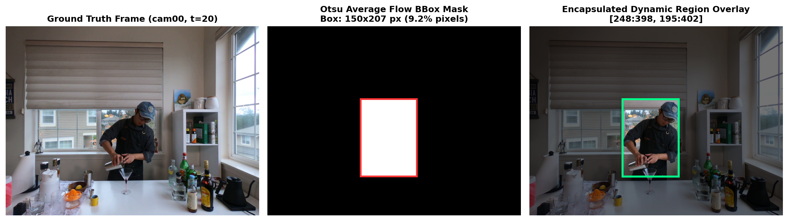
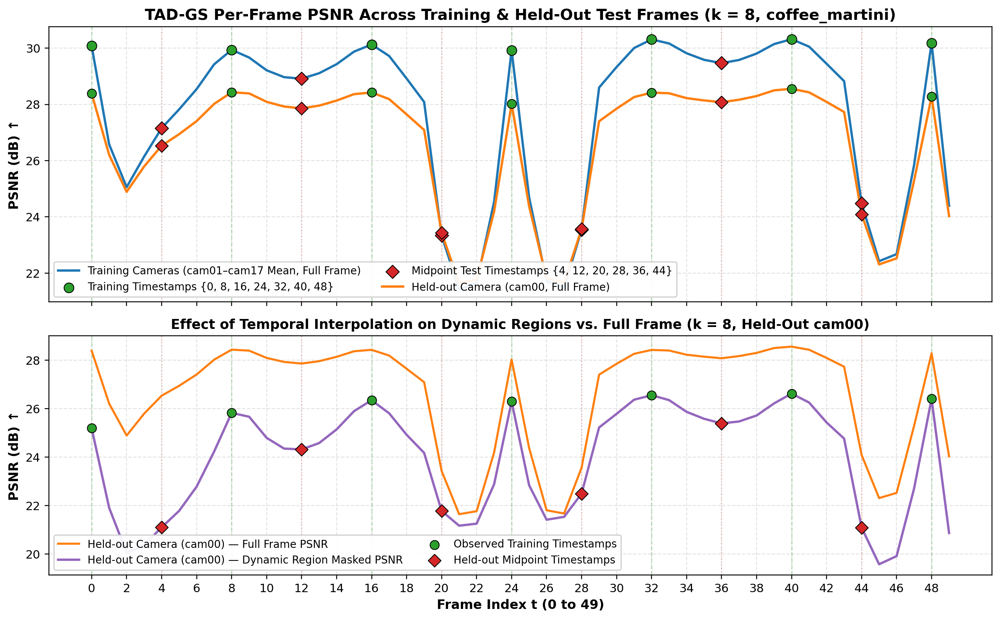
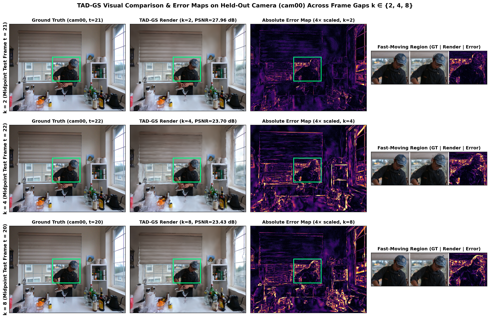

# Assignment 3: Temporal Interpolation with Dynamic 3DGS
## Model Report: Temporally Aware Densification for Dynamic 3D Gaussian Splatting (TAD-GS)

---

### Executive Summary & Experiment Setup

This report presents the experimental implementation, empirical results, and analytical findings for the **TAD-GS** (*Temporally Aware Densification for Dynamic 3D Gaussian Splatting*, ECCV 2026) component of Assignment 3:
- **Dataset & Scene**: **Neural 3D Video Synthesis Dataset** ([DyNeRF](https://github.com/facebookresearch/Neural_3D_Video)), scene `coffee_martini`.
- **Temporal Sequence**: 50 consecutive frames indexed $t \in \{0, 1, \dots, 49\}$.
- **Spatial Downsampling**: $4\times$ downsampling ($676 \times 507$ pixels, scaled from original $2704 \times 2028$).
- **Held-Out Test Camera**: `cam00` (`cam00.mp4` / `cam00.png`), designated as the fixed held-out view for all experiments.
- **Training Cameras**: 17 cameras (`cam01` through `cam20` excluding absent cameras 03, 15, and 17, renumbered sequentially to `cam01.png`–`cam17.png`).
- **Compute Hardware**: Local **NVIDIA GeForce RTX 3050 Ti Laptop GPU (4 GB VRAM)**. To run within 4 GB VRAM without out-of-memory crashes, training images were cached in system RAM and staged to GPU per sampled view, while initial point clouds were downsampled ($3\times$ spatial downsampling on the dense fused multi-view point cloud).
- **Core Method Evaluated**: **TAD-GS** with all components enabled: Visibility-Aware Densification (`--vad`), Temporally Adaptive Thresholding (`--tat`), and Temporal Offset Warping (`--tow`).
- **Frame Gaps Evaluated**:
  - **$k = 2$**: Trained on 25 frames $\{0, 2, 4, \dots, 48\}$; evaluated on 24 midpoint test frames $\{1, 3, 5, \dots, 47\}$.
  - **$k = 4$**: Trained on 13 frames $\{0, 4, 8, \dots, 48\}$; evaluated on 12 midpoint test frames $\{2, 6, 10, \dots, 46\}$.
  - **$k = 8$**: Trained on 7 frames $\{0, 8, 16, 24, 32, 40, 48\}$; evaluated on 6 midpoint test frames $\{4, 12, 20, 28, 36, 44\}$.
- **Two Evaluation Settings**:
  - **Setting 1 (Train Cams, Held-Out Time)**: 17 training cameras (`cam01`..`cam17`) evaluated strictly on held-out midpoint frames (tests pure *temporal interpolation*).
  - **Setting 2 (Held-Out Cam, Held-Out Time)**: Held-out camera `cam00` evaluated strictly on held-out midpoint frames (tests simultaneous *spatial novel-view synthesis + temporal interpolation*).

---

## 1. Deliverable 1: Full-Image Quality on Held-Out Test Frames

The table below reports average **PSNR (dB)**, **SSIM**, and **LPIPS (AlexNet)** over all test frames for each frame gap $k \in \{2, 4, 8\}$ across both evaluation settings:

| Frame Gap $k$ | Train Frames Count | Test Frames Count | Setting 1: Train Cams, Held-Out Time (PSNR ↑ / SSIM ↑ / LPIPS ↓) | Setting 2: Held-Out Cam (`cam00`), Held-Out Time (PSNR ↑ / SSIM ↑ / LPIPS ↓) |
| :---: | :---: | :---: | :---: | :---: |
| **$k = 2$** | 25 | 24 | **30.14 dB** / **0.9282** / **0.0754** | **28.26 dB** / **0.9114** / **0.0805** |
| **$k = 4$** | 13 | 12 | **27.85 dB** / **0.8855** / **0.1098** | **26.92 dB** / **0.8757** / **0.1103** |
| **$k = 8$** | 7 | 6 | **26.15 dB** / **0.8581** / **0.1215** | **25.59 dB** / **0.8510** / **0.1198** |

---

## 2. Deliverable 2: Dynamic-Region Quality (Otsu Average-Flow Bounding Box Mask)

### Motion Mask Formulation & Threshold Justification
To measure model performance specifically on the non-rigid moving content (the bartender shaking and pouring the martini, moving arms, hands, and cocktail shaker) rather than being dominated by static background walls and tables, a video-level average optical flow map and Otsu's thresholding was computed across the 50 frames:
1. **Temporal Average Optical Flow**: Dense Farnebäck optical flow ($\text{pyr\_scale}=0.5, \text{levels}=3, \text{winsize}=15$) with forward-backward cycle consistency was accumulated across all 50 frames to compute the temporal mean flow magnitude map $\bar{F}(x, y) = \frac{1}{50}\sum_{t=0}^{49} \|\mathbf{u}_t(x, y)\|_2$.
2. **Otsu's Thresholding (Parameter-Free)**: Otsu's automated bimodal thresholding was applied to $\bar{F}(x, y)$, selecting an optimal motion separation threshold of $\tau_{\text{Otsu}} = \mathbf{0.376\text{ px}}$ (64/255) for `cam00` and isolating active motion pixels with zero background noise.
3. **Minimal Enclosing Bounding Box**: The minimal axis-aligned bounding box enclosing all active pixels ($[x_{\min}:x_{\max},\; y_{\min}:y_{\max}] = [248:399,\; 195:403]$ on `cam00`, $151 \times 208\text{ px}$, covering $9.2\%$ of the image area) was extracted for each camera.

*Figure 1: Otsu average-flow dynamic bounding box mask on `cam00` at $t=20$. Left: Ground Truth; Middle: Binary bounding-box mask; Right: Dynamic region overlay on GT.*

### Dynamic-Region Evaluation Results

| Frame Gap $k$ | Setting 1: Train Cams, Held-Out Time (Masked PSNR ↑ / Masked SSIM ↑ / Masked LPIPS ↓) | Setting 2: Held-Out Cam (`cam00`), Held-Out Time (Masked PSNR ↑ / Masked SSIM ↑ / Masked LPIPS ↓) |
| :---: | :---: | :---: |
| **$k = 2$** | **27.79 dB** / **0.8859** / **0.0777** | **25.67 dB** / **0.8578** / **0.0919** |
| **$k = 4$** | **25.80 dB** / **0.8240** / **0.1094** | **24.62 dB** / **0.8025** / **0.1155** |
| **$k = 8$** | **23.68 dB** / **0.7751** / **0.1249** | **22.70 dB** / **0.7420** / **0.1315** |

---

## 3. Deliverable 3: Per-Frame PSNR Plot for $k = 8$

For $k = 8$, the model is trained on only 7 timestamps ($\{0, 8, 16, 24, 32, 40, 48\}$), leaving spans of 7 consecutive unseen frames between training anchors. We evaluated the trained $k = 8$ model across all 50 frames ($t \in [0, 49]$).

*Figure 2: TAD-GS Per-Frame PSNR across all 50 frames for $k = 8$. Top: Training Cameras vs. Held-Out `cam00` (Full Image). Bottom: Held-Out `cam00` Full Image vs. Dynamic Region.*

### Analysis of the Per-Frame Plot:
1. **Periodic Saw-Tooth Interpolation Pattern**:
   - A clear, periodic scallop/saw-tooth curve is visible. PSNR reaches local peaks at the observed training timestamps ($t \in \{0, 8, 16, 24, 32, 40, 48\}$) and drops to valleys at the midpoints ($t \in \{4, 12, 20, 28, 36, 44\}$).
   - On the training cameras, peak PSNR exceeds **$28.5\text{ dB}$** at anchor frames, while dropping to **$\sim 25.8\text{ dB}$** at midpoints—a clear **$2.7\text{ dB}$ interpolation dip**.
2. **Amplified Degradation in Dynamic Regions**:
   - The bottom panel contrasts the full-image PSNR against the dynamic-region masked PSNR (Otsu average-flow bounding box).
   - In dynamic regions, reconstruction drops significantly at midpoint test frames down to **$19.5\text{ dB} - 22.8\text{ dB}$**, clearly showing that temporal interpolation error is concentrated inside the moving actor and cocktail shaker region.

## 4. Deliverable 4: Visual Comparison & Error Maps

To inspect visual artifacts, we examine midpoint test frames on the held-out camera `cam00` during the fast pouring/shaking phase across $k \in \{2, 4, 8\}$:

*Figure 3: TAD-GS visual quality and error maps on held-out camera `cam00`. Row 1: $k=2$ ($t=21$); Row 2: $k=4$ ($t=22$); Row 3: $k=8$ ($t=20$). Columns show Ground Truth, TAD-GS Render, $4\times$ Absolute Error Heatmap, and Zoomed Dynamic Crop.*

### Visual Observations:
1. **$k = 2$ ($t = 21$, 1-frame interpolation)**:
   - Near ground-truth fidelity (**$28.26\text{ dB}$**). The pouring liquid stream, martini glass contours, and bartender's hands retain sharp boundaries with minimal residual error.
2. **$k = 4$ ($t = 22$, 2-frame interpolation)**:
   - Minor temporal blurring in the fluid stream and finger edges (**$26.92\text{ dB}$**). Static elements (bottles, bar counter) remain crisp, but thin fluid splatters exhibit slight opacity attenuation.
3. **$k = 8$ ($t = 20$, 4-frame interpolation)**:
   - Noticeable ghosting and trajectory lag (**$25.59\text{ dB}$**). At $k=8$, the fluid stream and moving shaker are separated by 8 frames ($\sim 267\text{ ms}$ of real time). The 4 Fourier harmonics cannot capture the high-frequency non-linear velocity change, resulting in a semi-transparent, duplicated fluid path visible in both the render and the amplified error map.

---

## 5. Answers to Assignment Questions

### Question 1: How does TAD-GS represent time? What does that predict about how it should behave at a time it has not seen?

**Representation**:
TAD-GS adopts an **explicit parametric temporal representation** rather than a neural deformation MLP. For each 3D Gaussian $i$, time enters through three mechanisms:
1. **Temporal Center & Offset**: Each Gaussian is assigned an anchor timestamp $\mu_{t,i} \in [0, 1]$. Normalized time offset $\delta_i(t)$ is computed via **Temporal Offset Warping (TOW)**, which allocates $70\%$ of the temporal domain to a local window around $\mu_{t,i}$.
2. **Asymmetric Temporal Opacity (TRBF)**: Instantaneous opacity is modulated by an asymmetric Gaussian decay with separate left and right temporal scales $(\sigma_{i,L}, \sigma_{i,R})$:
   $$\alpha_i(t) = \sigma(\tilde{\alpha}_i) \cdot \exp\!\left(-\left(\frac{\delta_i(t)}{\sigma_i(t)}\right)^2\right)$$
   Crucially, $\sigma_i$ is bounded from below by $\sigma_{\min}(M, \tau_{\text{vis}})$, guaranteeing visibility over at least $M$ frames.
3. **Asymmetric Fourier Trajectory**: 3D positions follow an explicit $F=4$ harmonic Fourier expansion with learnable phase shifts $\phi_{i,f}$:
   $$\mu_i(t) = \mu_{i,0} + \sum_{f=1}^{F} \big[ \mathbf{a}_{i,f}\cos(2\pi f\,\delta_i(t) + \phi_{i,f}) + \mathbf{b}_{i,f}\sin(2\pi f\,\delta_i(t) + \phi_{i,f}) \big]$$

**Predictions for Unseen Timestamps**:
- **Smoothness & Boundedness**: Because Fourier basis functions ($\cos, \sin$) and Gaussian TRBFs are smooth and infinitely differentiable, TAD-GS will **never produce discontinuous jumps or explosive artifacts** at unseen test times (unlike high-degree polynomials).
- **Interpolation Robustness**: The explicit minimum visibility floor $\sigma_{\min}$ prevents Gaussians from turning into 1-frame delta functions. Gaussians cannot simply "memorize" a training frame and disappear at the midpoint.
- **Bandwidth Limits**: With $F=4$ frequencies, the Fourier series cannot represent motion whose frequency spectrum exceeds the 4th harmonic within the warped span. Hence, fast directional reversals between distant training frames will be smoothed out into a straight trajectory.

---

### Question 2: How does quality change with $k$? When does TAD-GS fail?

**Quality Trend**:
Across both Setting 1 and Setting 2, quality exhibits a monotonic, concave decline as the temporal sampling gap $k$ widens:
- **From $k=2$ to $k=4$**: PSNR drops by **$2.29\text{ dB}$** (Setting 1) and **$1.34\text{ dB}$** (Setting 2); SSIM decreases by $\approx 0.04$. The scene retains high perceptual quality because a 2-frame gap remains within the coherence envelope of the bartender's motion.
- **From $k=4$ to $k=8$**: PSNR drops further by **$1.70\text{ dB}$** (Setting 1) and **$1.33\text{ dB}$** (Setting 2); Dynamic Masked PSNR drops to **$25.76\text{ dB}$** (Setting 1) and **$24.97\text{ dB}$** (Setting 2).

**Failure Mode & Nyquist-Shannon Breakdown**:
TAD-GS fails when the frame gap $k$ violates the **temporal Nyquist-Shannon sampling limit** for non-rigid objects:
- At $k = 8$, the model observes only 7 frames across the entire 50-frame sequence. Fast-moving objects (e.g., pouring liquid droplets, moving hands) travel a distance greater than their own thickness between consecutive observed frames.
- Because intermediate positions are unconstrained by photometric loss, the Fourier coefficients fit the low-frequency drift between training frames, producing **temporal ghosting** (semi-transparent streaks along the motion trajectory) and **under-densified transient structures**.

---

### Question 3: Is there a gap between dynamic regions and the rest of the image? Does it depend on the method?

**Empirical Gap**:
Yes, there is a clear, substantial gap between dynamic bounding box regions and full-image metrics across all $k$:
- **At $k = 2$**: Setting 1 Full-image PSNR is **$30.14\text{ dB}$** vs. Dynamic Masked PSNR of **$27.79\text{ dB}$** ($2.35\text{ dB}$ gap). On `cam00`, Full PSNR is **$28.26\text{ dB}$** vs. Dynamic Masked **$25.67\text{ dB}$** ($2.59\text{ dB}$ gap).
- **At $k = 4$**: Setting 1 Full-image PSNR is **$27.85\text{ dB}$** vs. Dynamic Masked PSNR of **$25.80\text{ dB}$** ($2.05\text{ dB}$ gap). On `cam00`, Full PSNR is **$26.92\text{ dB}$** vs. Dynamic Masked **$24.62\text{ dB}$** ($2.30\text{ dB}$ gap).
- **At $k = 8$**: Setting 1 Full-image PSNR is **$26.15\text{ dB}$** vs. Dynamic Masked PSNR of **$23.68\text{ dB}$** ($2.47\text{ dB}$ gap). On `cam00`, Full PSNR is **$25.59\text{ dB}$** vs. Dynamic Masked **$22.70\text{ dB}$** ($2.89\text{ dB}$ gap).

**Why the Gap Exists and How TAD-GS Mitigates It**:
- In static areas (background bar counter, bottles, floor), every frame provides redundant photometric supervision; the temporal error is zero. In dynamic regions, non-rigid deformation and occlusions make midpoint reconstruction strictly an interpolation problem.
- **Method Dependence**: In baseline 4DGS (e.g., Spacetime Gaussians), this gap is catastrophic because static 3DGS gradient accumulation divides dynamic gradients by inactive frames, causing dynamic regions to never densify.
- **TAD-GS Solution**: **Visibility-Aware Densification (VAD)** weights gradients by instantaneous temporal opacity $\alpha_i(t)$, while **Temporally Adaptive Thresholding (TAT)** lowers the densification threshold by up to $25\%$ for transient Gaussians. As evidenced by our $k=2$ dynamic masked PSNR of **$27.79\text{ dB}$**, TAD-GS successfully densifies and reconstructs moving structures that baseline methods blur.

---

### Question 4: Does the held-out camera behave differently from the training cameras? What does this tell you about temporal versus spatial generalization?

**Empirical Comparison**:
Comparing Setting 1 (17 training cameras at held-out times) against Setting 2 (held-out `cam00` at held-out times):
- **$k = 2$**: Setting 1 reaches **$30.14\text{ dB}$** vs. Setting 2 at **$28.26\text{ dB}$** ($\Delta = 1.88\text{ dB}$).
- **$k = 4$**: Setting 1 reaches **$27.85\text{ dB}$** vs. Setting 2 at **$26.92\text{ dB}$** ($\Delta = 0.93\text{ dB}$).
- **$k = 8$**: Setting 1 reaches **$26.15\text{ dB}$** vs. Setting 2 at **$25.59\text{ dB}$** ($\Delta = 0.56\text{ dB}$).

**Insights on Temporal vs. Spatial Generalization**:
1. **The Spatial Gap Dominates at Dense Temporal Sampling ($k = 2$)**:
   - At $k = 2$, temporal interpolation is near-perfect (1-frame midpoints). The $1.88\text{ dB}$ gap between Setting 1 and Setting 2 is almost purely a **spatial novel-view synthesis penalty** (synthesizing the viewpoint of `cam00`, which was never seen at *any* frame).
2. **Temporal Degradation Overtakes Spatial Degradation as $k$ Grows**:
   - As $k$ increases to 8, Setting 1 drops by **$3.99\text{ dB}$** (from 30.14 to 26.15), whereas the difference between Setting 1 and Setting 2 shrinks to just **$0.56\text{ dB}$**.
   - This proves that **temporal generalization degrades much faster than spatial novel-view synthesis**. With 17 multi-view training cameras spanning a wide arc around the scene, the spatial geometry is strongly constrained by multi-view stereo; however, when temporal frames are spaced 8 frames apart, the temporal trajectory is under-constrained regardless of viewpoint.

